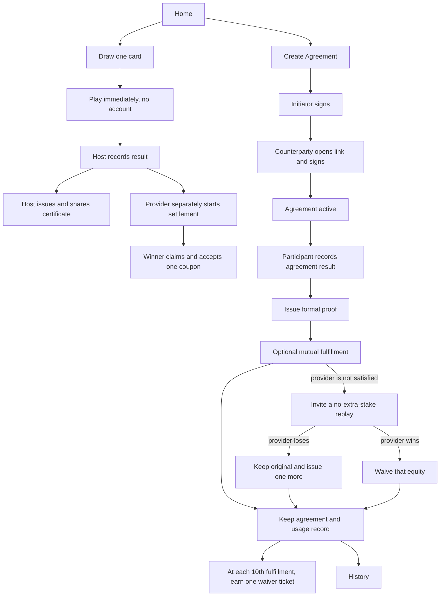

# Page And Route Map

The canonical web app is the React player in `apps/player` and uses
`react-router-dom`. The routes below are the current page boundaries; they can
later map to mini-program pages without changing the domain model.

## Page Map

| Path | Page | Identity |
| --- | --- | --- |
| `/` | Game card feed and play | Optional |
| `/promise` | Create and sign an existing-life agreement | Required at submit |
| `/share/:shareCode` | Read a pending agreement and sign as counterparty | Read public; sign requires account |
| `/benefits` | Equity center and issued/received benefits | Required for personal records |
| `/claim/:token` | Claim a public benefit link | Public while claimable |
| `/me` | Profile, agreements, and account actions | Optional until persistence |
| `/agreements` | Personal agreement archive | Required |
| `/agreements/:id` | Agreement document, signatures, and current state | Participant only |
| `/notifications` | Personal notifications | Required |
| `/announcements` | Product announcements | Optional |

The root player owns only the card currently being played. It does not create
an Agreement, Coupon, or Flip. Result recording, certificates, and independent
settlement remain planned backend boundaries and are not represented as legacy
`/games` compatibility routes.

## Agreement State

| State | Meaning | Equity behavior |
| --- | --- | --- |
| `pending_signature` | Initiator signed; waiting for counterparty | No coupon |
| `active` | Both participants signed | In-play boosts may be proposed |
| `result_recorded` | A participant recorded the agreed result | Coupon is issued to holder; provider may fulfill it |
| `fulfilled` | Holder and provider completed redemption | Agreement and coupon remain in history |
| `waived` | Participants confirmed a waiver for the original equity | Agreement and waiver decision remain in history |

Result submission records the submitting participant. Playbit does not judge
the event or enforce fulfillment. A play-again action is a new game entry, not
an appeal or mutation of the old result.

## Flip And Waiver

- A flip starts from an available equity awaiting fulfillment. The provider
  invites the holder; accepting starts a card game without choosing or adding
  another stake.
- If the provider is recorded as the winner, that coupon is waived. If the
  provider loses, the original coupon remains and one new coupon with the same
  terms is issued. Each coupon keeps its own identity under the same Agreement.
- A 赖皮券 is issued for every 10-fulfillment milestone. Its holder may request
  waiver of one available equity; the equity holder confirms or declines.
  Declining restores both the coupon and ticket. Confirming waives only that
  coupon and retains the Agreement and request history.
- A proof image is derived from the current Agreement or Flip record and is
  created only when a participant chooses to issue or share it.

## API Boundary

| API | Purpose | Identity |
| --- | --- | --- |
| `GET /content/cards/next` | Read the next published card | None |
| `GET /content/cards/featured` | Read featured cards | None |
| `POST /content/play-sessions` | Start an optional server-observed play session | None |
| `POST /content/play-sessions/:id/events` | Record play events | Session owner |
| `POST /content/play-sessions/:id/complete` | Complete a play session | Session owner |
| `POST /content/preferences` | Save a card preference | Account or actor key |
| `POST /agreements`, `GET /agreements` | Create/list personal agreements | Account |
| `GET /agreements/:id`, `GET /agreements/:id/events` | Read and synchronize an agreement | Participant |
| `GET /share/:shareCode` | Read a pending shared agreement | Public while pending |
| `POST /share/:shareCode/sign` | Sign as invited counterparty | Account, non-initiator |
| `PATCH /agreements/:id/result` | Record a participant-selected result | Participant |
| `POST /agreements/:id/fulfill` | Record fulfillment of point/custom equity | Participant |
| `POST /agreements/:id/boost` and `/boost/:id/confirm` | Amend the existing equity | Participant; both confirm |
| `GET /coupons`, `PATCH /coupons/:id/use` | Read or redeem equity | Account; holder redeems |
| `POST /agreements/:id/flips`, `/flips/:id/*` | Invite, accept/decline, and record a replay | Agreement/Flip participants |
| `GET /grace`, `POST /grace/:ticketId/waivers`, `PATCH /grace/waivers/:id` | Earn and mutually apply waiver tickets | Account; provider requests, holder responds |
| `POST /speech/transcribe` | Transcribe a recorded voice note | None; API key stays server-side |

